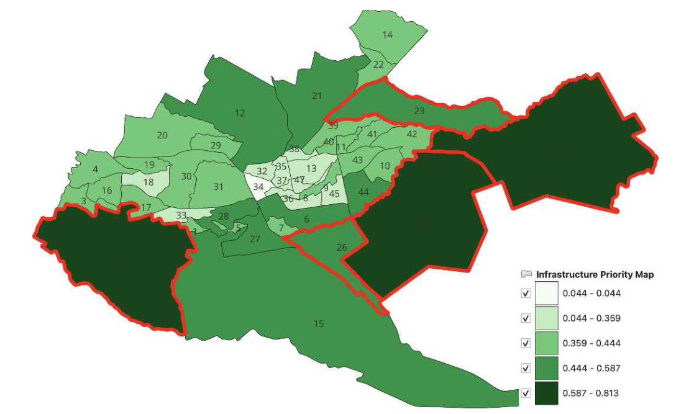
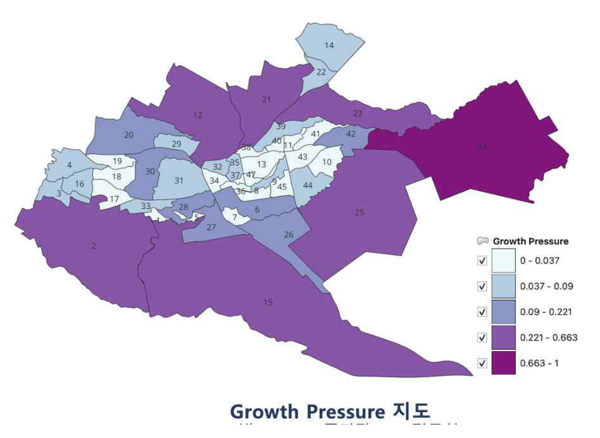
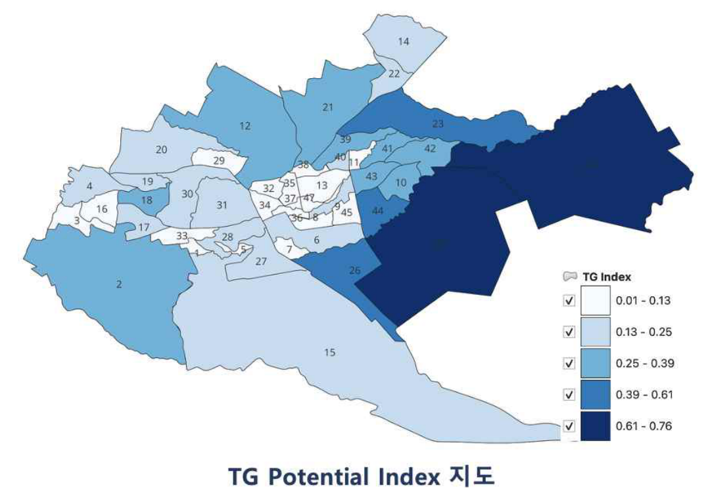
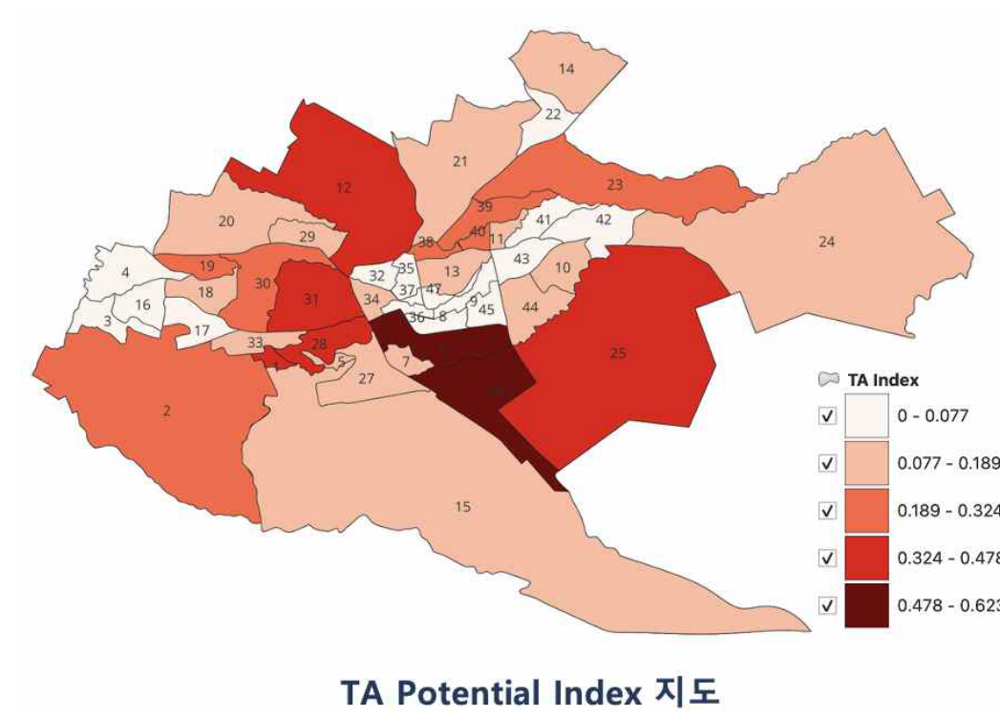
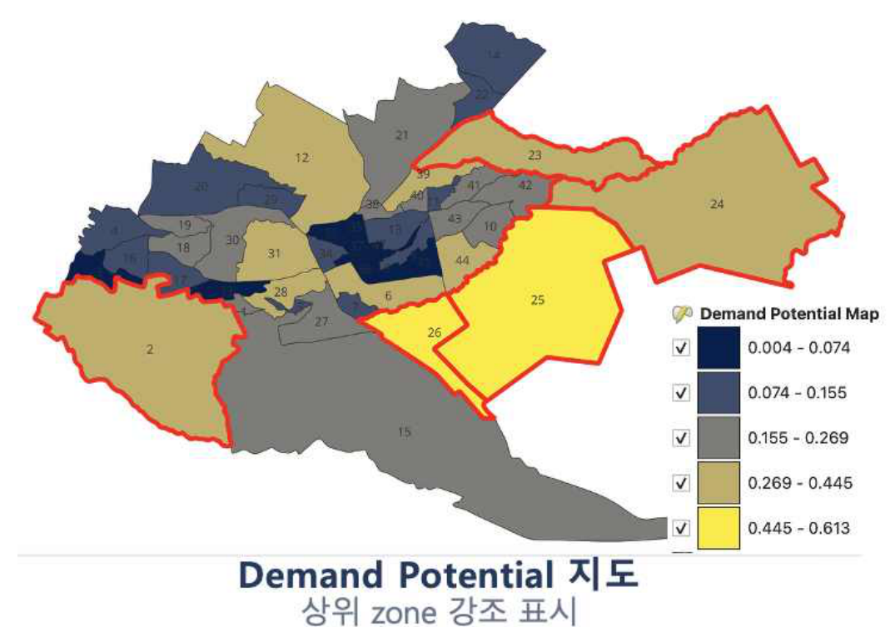

# 나이로비 교통인프라 투자 우선지역 분석

**Google Earth Engine · QGIS · 위성영상 · 공간정보분석 · 교통계획**

실측 통행발생·유인 자료가 부족한 나이로비 광역권에서 **위성영상과 공개 공간자료를 활용해 교통인프라 투자 우선 검토지역을 선별**한 연구 프로젝트입니다.

## 프로젝트 개요

- **연구지역:** 케냐 나이로비 광역권
- **분석단위:** NIUPLAN 기반 연구용 재구축 47개 Medium Zone
- **주요 도구:** Google Earth Engine(GEE), QGIS
- **활용자료:** Dynamic World, Google Open Buildings, KNBS 인구, OSM POI, Digital Matatus, NIUPLAN
- **목적:** 실측 교통량이 아닌 *상대적인* 통행발생·유인 잠재량을 산정하여 투자 우선 검토지역을 식별

## 수행 내용

1. 위성 및 공개 공간자료의 수집, 전처리와 공간 집계
2. 2016~2023년 Built-up 변화 분석
3. 인구, 건물, 토지피복, POI를 이용한 통행발생(TG)·통행유인(TA) 잠재량 산정
4. 수요잠재량 및 성장압력을 결합한 핵심 우선지수 도출
5. Matatu 정류장 자료를 이용한 공급격차 검토 및 공간적 검증
6. GEE 공간분석과 QGIS 결과 시각화

## 분석 결과

- 분석지역 Built-up 면적: **250.89㎢ (2016) → 300.64㎢ (2023), 약 19.83% 증가**
- 투자 우선 검토 상위 Zone: **24, 25, 2, 26, 23**
- 통행유인 잠재량과 Matatu 정류장 수: **Spearman ρ = 0.481, p = 0.0006**
- 동일가중과 PCA 기반 가중치 비교: **ρ = 0.999**, 상위 5개 Zone 유지

| 성장압력 | 통행발생 잠재량 |
|---|---|
|  |  |
| 통행유인 잠재량 | 종합 수요잠재량 |
|  |  |

**해석 주의:** 제시된 지표는 실측 통행량이나 교통량 예측이 아닌 상대적 잠재량입니다. 분석단위 크기, 자료 기준연도 불일치, POI 등록 누락 등 연구의 한계가 있습니다. 원본 GEE 코드, QGIS 프로젝트 및 원자료는 현재 저장소에 포함되지 않아 전체 분석을 그대로 재현할 수 없습니다.

자세한 방법과 주요 결과는 [영문 README](README.md)를 참고해 주세요.
